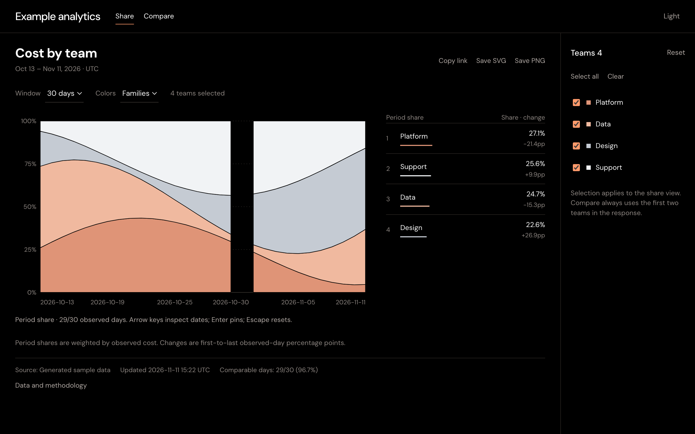
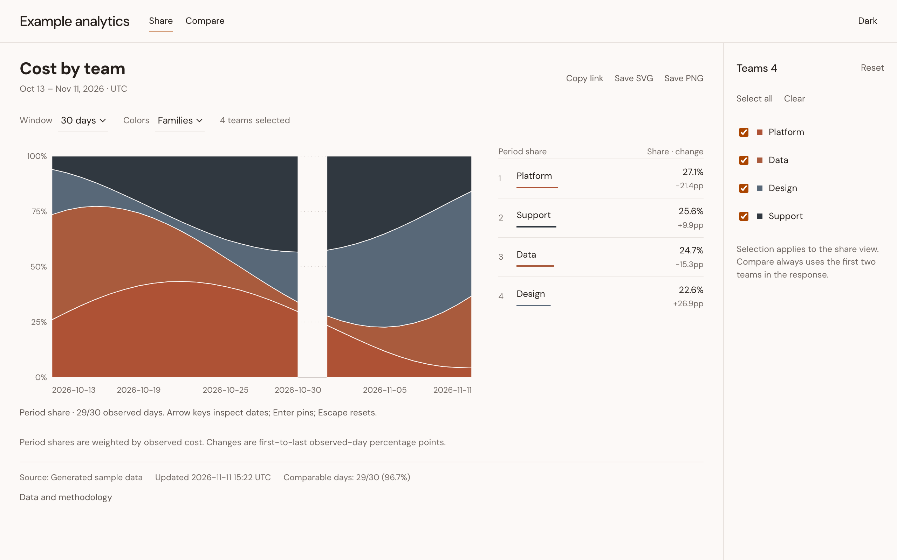
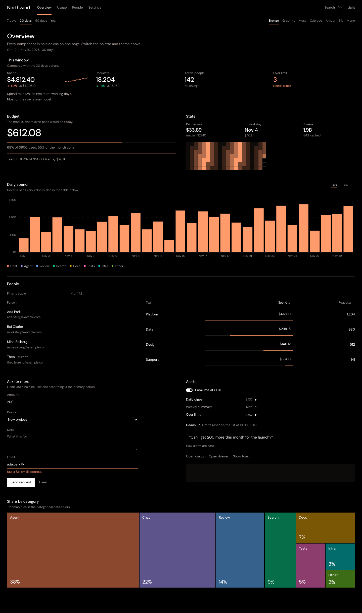
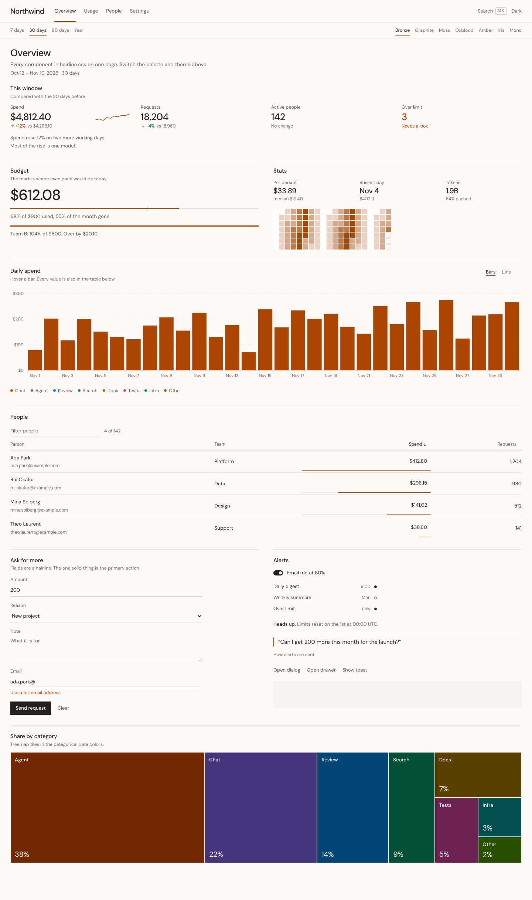
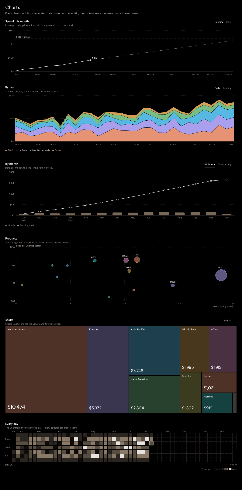
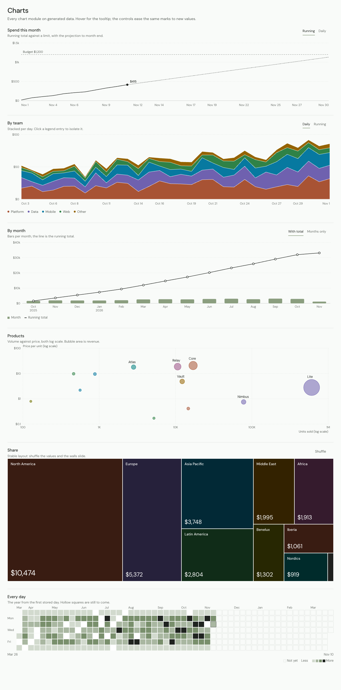

# Hairline skills

Project-agnostic agent skills for flat, type-led interfaces, a small Go + Svelte stack, hand-built SVG charts, and restrained motion. Keep your own product, data, framework, and brand colors.

[](https://skills.sh/Sma-Das/hairline-skills)

## Install

```sh
npx skills add Sma-Das/hairline-skills
```

Choose the skills and coding agents when prompted. To select all four skills:

```sh
npx skills add Sma-Das/hairline-skills --skill '*'
```

| Skill | What it provides | Companion |
| --- | --- | --- |
| [hairline-ui](skills/hairline-ui/SKILL.md) | Flat layouts, typography, accessible controls, dark and light themes, seven palettes, and a custom palette generator | Independent |
| [hairline-stack](skills/hairline-stack/SKILL.md) | Go API with embedded Svelte 5 + Vite UI, dashboard or analysis workspace, sample data, tests, Dockerfile, and CI scaffold | Install hairline-ui alongside it |
| [hairline-charts](skills/hairline-charts/SKILL.md) | SVG share and signed comparison charts, linked rankings, trends, scatter, treemap, and calendar heatmap | Install hairline-ui alongside it |
| [hairline-motion](skills/hairline-motion/SKILL.md) | Motion decisions, curves, springs, interruption handling, FLIP, and reduced motion | Independent |

The agent instructions focus on design intent, decisions, and implementation quality. Detailed recipes and reusable code are supporting resources, rather than file catalogs in the skill entry points.

The analysis workspace combines DM Sans display typography, optional related color families, a normalized share chart or signed two-group comparison, linked keyboard/touch inspection, a responsive filter rail, source and coverage notes, shareable view state, and portable SVG/PNG exports. Bright categorical colors remain available.

The skills work with agents that support the [Agent Skills format](https://agentskills.io/). Each folder includes its instructions, references, and reusable assets.

## Use

- “Use hairline-ui to design an inventory dashboard. Recommend a palette that suits the product.”
- “Use hairline-stack to scaffold a Go and Svelte app for project planning.”
- “Use hairline-charts to show monthly totals and a running total.”
- “Use hairline-motion to make this drawer interruptible and respect reduced motion.”

Bright, saturated color recommendations cover copper-orange, sky blue, leaf green, red-coral, gold, violet, and monochrome chrome with vivid categorical colors. Dark and light themes share semantic tokens; a generator creates custom palettes and checks contrast. The style does not require black and bronze.

## Previews

Generated, fictional data only.

| Analysis workspace, dark | Analysis workspace, light |
| --- | --- |
|  |  |

[Mobile workspace](skills/hairline-stack/references/analysis-mobile.png) · [Signed comparison](skills/hairline-stack/references/comparison-dark.png)

| Dark | Light |
| --- | --- |
|  |  |
|  |  |

The interactive specimens use ES modules and must be served over HTTP. Serve the `skills/` directory on an address appropriate for your environment, then open `hairline-ui/assets/specimen.html`, `hairline-charts/assets/specimen.html`, or `hairline-motion/assets/demo.html`. Keep sibling skill folders together for their relative asset imports.

## Development

```sh
node scripts/check.mjs
node --test skills/hairline-charts/assets/js/layout.test.mjs
node skills/hairline-ui/scripts/palette.mjs --all
bash skills/hairline-stack/scripts/scaffold.sh /tmp/hairline-example example.com/hairline-example "Example dashboard"
cd /tmp/hairline-example/web/ui
npm install
npm test
npm run build
cd ../..
go vet ./...
go test ./...
```

For the analysis layout, use `bash skills/hairline-stack/scripts/scaffold.sh --layout analysis /tmp/hairline-analysis example.com/hairline-analysis "Example analytics"`. It needs the UI and charts skills installed alongside the stack skill.

The scaffold requires Node 22 and Go 1.22 or newer. Commit the generated npm lockfile, then use `npm ci` for subsequent installs. The repository workflow runs these checks on pull requests and pushes.

## License

Instructions, code, and original assets are MIT licensed; see [LICENSE](LICENSE). The bundled DM Sans font uses the SIL Open Font License; retain [FONT-LICENSE.txt](skills/hairline-ui/assets/FONT-LICENSE.txt) when redistributing it.
